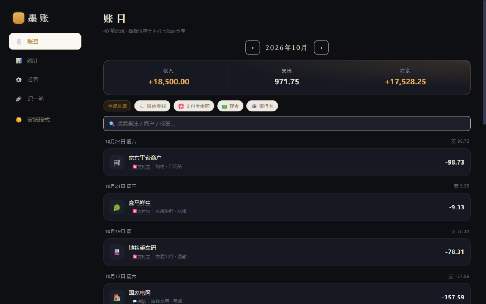
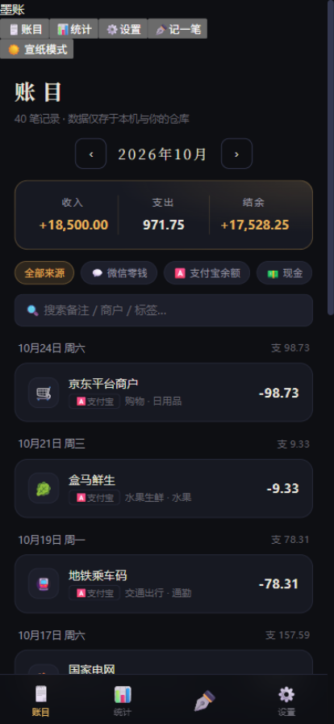
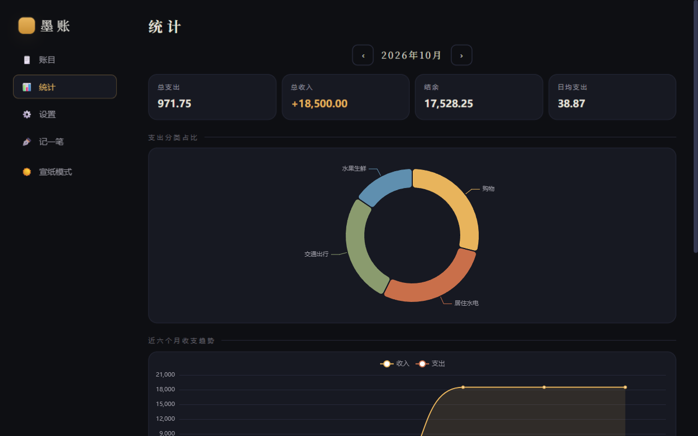
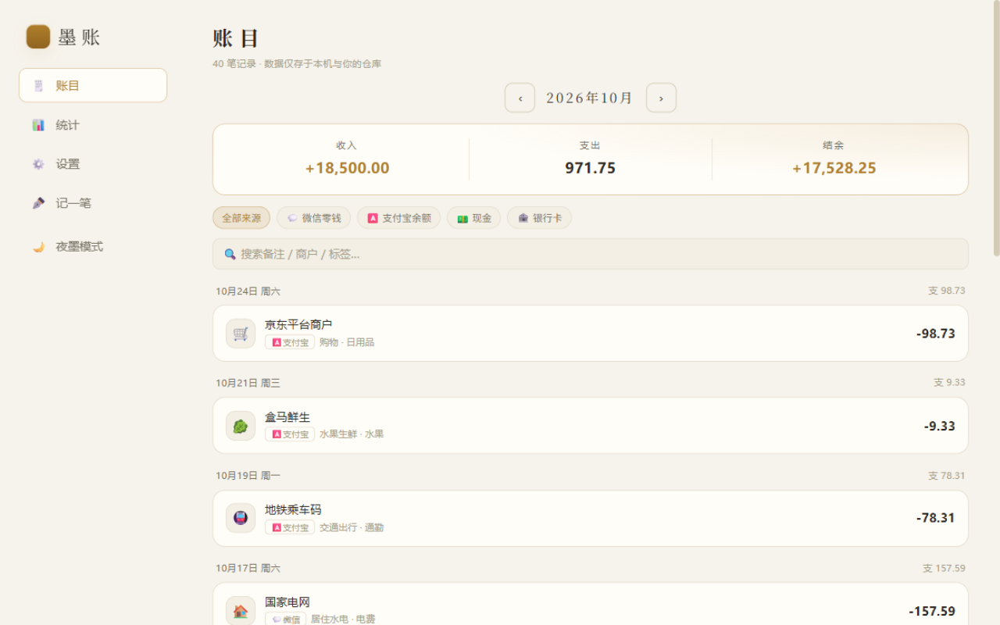

<div align="center">

# 墨账 · InkLedger

**一款「墨与金」风格的纯静态记账应用 —— 无后端、无数据库、数据完全自持**

PWA · 微信 / 支付宝账单导入 · GitHub 私有仓库同步 · 自动归类

[](https://github.com/rwzdk/inkledger/stargazers)
[](./README.md#-更新日志)
[](./LICENSE)
[](https://vuejs.org/)
[](https://vitejs.dev/)
[](https://github.com/rwzdk/inkledger/actions)

</div>

---

## 这是什么

墨账是一个**部署在哪里都能跑**的个人记账本：

- **纯静态**：构建产物只是一堆 HTML/JS/CSS，任何静态托管（Qoder Sites、Cloudflare Pages、Vercel、GitHub Pages…）免费部署，永不担心服务停机
- **数据自持**：账单保存在浏览器本地，可随时同步到你自己的 **GitHub 私有仓库**——不经过任何第三方服务器，天然带版本历史
- **微信 / 支付宝账单导入**：上传官方导出的账单 CSV，自动识别消费来源账户、按关键词自动归类、按交易单号去重
- **离线可用**：PWA + Service Worker，记账这件事不需要网络

> 🌐 **在线体验**：[rwzdk.github.io/inkledger/#demo](https://rwzdk.github.io/inkledger/#demo)（`#demo` 会自动载入示例数据；深链 `#stats` / `#settings` / `#add` / `#light` 可直达对应视图）
>
> 另有 Qoder Sites 私有部署：`inkledger-j8vzdjdlheu.qoder.website`（需 Qoder 账号登录访问）

## 界面预览

| 桌面端 · 夜墨主题 | 移动端 |
|:---:|:---:|
|  |  |
| **统计图表** | **宣纸（浅色）主题** |
|  |  |

## ✨ 功能特性

- 🗒️ **记账**：支出 / 收入 / 转账，二级语义清晰的账户体系（微信零钱、支付宝、现金、银行卡…即「消费来源」）
- 📥 **账单导入**：微信支付、支付宝官方导出的 CSV 一键导入；自动建户（按银行卡尾号识别同一账户）、关键词自动归类、交易单号去重、退款标记
- 📊 **统计分析**：分类占比环图、近六个月收支趋势、消费来源分布、分类排行与日均支出
- ☁️ **GitHub 同步**：Fine-grained PAT 授权，自动创建私有数据仓库，多端按 `updatedAt` 合并
- 🎨 **双主题**：夜墨（默认）/ 宣纸，暗色为 OLED 友好的纯黑底 + 鎏金点缀
- 📱 **PWA**：可安装到手机桌面，Service Worker 离线访问
- 🔒 **隐私**：无统计、无追踪、无后端；Token 仅存于浏览器 localStorage

## 🚀 快速开始

### 本地开发

```bash
git clone https://github.com/rwzdk/inkledger.git
cd inkledger
pnpm install    # 或 npm install
pnpm dev        # http://localhost:5173
```

### 部署

墨账是纯静态应用，`pnpm build` 后把 `dist/` 扔到任意静态托管即可。
**Qoder Sites / Cloudflare Pages / Vercel / Netlify / GitHub Pages** 的图文步骤见 [DEPLOY.md](./DEPLOY.md)。

[](https://vercel.com/new/clone?repository-url=https://github.com/rwzdk/inkledger)

## 📥 如何导出微信 / 支付宝账单

| 平台 | 路径 | 说明 |
|---|---|---|
| 微信 | 我 → 服务 → 钱包 → 账单 → 右上角「…」→ 导出账单记录 → 用于个人对账 | 新版直接生成 **xlsx**，旧版经邮箱发送 CSV（解压密码为身份证号）；两种都支持 |
| 支付宝 | 我的 → 账单 → 右上角「…」→ 开具交易流水 / 对账单 | 解压后得到 CSV |

导出后在墨账「设置 → 微信 / 支付宝账单导入」上传即可。xlsx / CSV 自动识别；CSV 支持 UTF-8 与 GBK 编码；xlsx 内的 Excel 序列日期会自动转换。已用真实微信账单（134 笔）验证：导入笔数与金额和账单自述完全一致。

## ☁️ 数据同步与隐私

1. 在 [GitHub Settings → Developer settings](https://github.com/settings/tokens?type=beta) 创建 **Fine-grained Token**（只需仓库读写权限，建议设置有效期）
2. 在墨账「设置 → GitHub 同步」粘贴 Token 并校验
3. 点击「立即同步」——首次会自动创建 `<你的用户名>-inkledger-data` **私有仓库**，账本以 `data.json` 存于其中

Token 与数据都不会离开你的浏览器到任何第三方服务器（仅 GitHub 官方 API）。合并策略为按条目 `updatedAt` 新者胜。

## 🧱 技术栈

- [Vue 3](https://vuejs.org/)（Composition API，无 UI 框架依赖，样式手写设计系统）
- [Vite 6](https://vitejs.dev/)
- [ECharts 5](https://echarts.apache.org/)（按需引入 Tree-shaking）
- 原生 PWA（手写 Service Worker）

账单导入解析器为纯函数实现，测试覆盖见 `tests/`（`pnpm test`）。

## 🗺 Roadmap

- [ ] 预算管理与超支提醒
- [ ] 账单快照识别（截图 OCR）
- [ ] WebDAV / S3 同步端点
- [ ] 数据报表导出（Excel / PDF）

## 🤝 贡献

欢迎 Issue 与 PR。提交前请跑 `pnpm test && pnpm build`。

## 📝 更新日志

### v1.4.0（2026-10-26）

- **feat**：**周期账单 / 订阅管理**——房租、会员、话费等固定扣费设置周期（每月 / 每季 / 每年）与扣费日，首页「近期账单」到期提醒（逾期标红），点「缴账」一键入账并自动顺延；每月固定支出自动折算
- **feat**：统计新增**年度总览**——年份切换、年度总收支 / 结余 / 月均支出与 12 个月收支柱状图
- **feat**：数据管理新增**导出账目 CSV**（UTF-8 + BOM，Excel 直接打开不乱码）
- **feat**：键盘快捷键——`N` 记一笔、`/` 聚焦搜索、`Esc` 关闭弹层
- 周期账单数据随 GitHub 同步与备份导出，纯前端实现，不影响静态部署

### v1.3.0（2026-10-26）

- **feat**：**月度分类预算**——设置中为支出分类设定每月额度，首页新增预算执行卡片（总额度进度 + 各分类余/超提示，超支标红），预算数据随 GitHub 同步与备份导出
- **feat**：统计总支出新增**环比**（较上月 ±%，支升红 / 支降绿）
- **feat**：账目列表新增**类型筛选**（全部 / 支出 / 收入 / 转账）
- **feat**：记一笔金额框支持**算式输入**（如 `12+8`、`(30+6)/2`，失焦自动求值回显）
- **style**：应用图标全新设计——金字「墨」+ 账线落墨点，替换 favicon 与 PWA 全套图标

### v1.2.0（2026-10-25）

- **feat**：全站图标升级为 **Lucide 线性图标库**（统一 24×24 描边风格、颜色跟随主题）——导航、统计、记一笔、设置、主题切换、搜索、转账及全部分类与账户图标不再依赖 emoji，跨平台显示一致
- **feat**：新增图标注册表 `src/lib/icons.js` 与 `AppIcon` / `DataIcon` 组件；分类编辑器改为**图标点选器**（21 个语义图标）
- **compat**：旧数据兼容——已保存的分类若仍是默认 emoji 图标会自动升级为线性图标，自定义图标保持不变

### v1.1.0（2026-10-25）

- **feat**：支持微信新版 **xlsx 账单**直接导入——零依赖解析器（原生 `DecompressionStream` 解 zip + 正则解析 sheet XML），按文件魔数与 CSV 自动分流
- **feat**：适配真实账单数据特征——Excel 序列日期转换、`"/"` 空值清洗、空支付方式的红包收入默认记入零钱、商户名空白修剪
- **test**：新增匿名化 xlsx 夹具与 13 项断言，并以真实账单（134 笔）完成端到端验证（笔数与金额和账单自述一致）

### v1.0.1（2026-10-25）

GUI 黑盒功能测试后的问题修复：

- **fix**：点击已有账目无法打开编辑弹层，导致编辑/删除不可用——`TxEditor` 对 Vue 响应式对象使用 `structuredClone` 抛 `DataCloneError`，改为 JSON 深拷贝
- **fix**：移动端（<900px）桌面侧边栏未隐藏、堆叠在页面顶部——补充 `.sidenav` 基础 `display:none` 规则

### v1.0.0（2026-10-25）

首个版本：记账（支出/收入/转账）、微信/支付宝账单导入、统计图表、GitHub 私有仓库同步、夜墨/宣纸双主题、PWA 离线可用。

## 📄 许可证

[MIT](./LICENSE) © rwzdk
